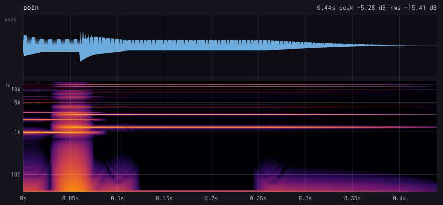
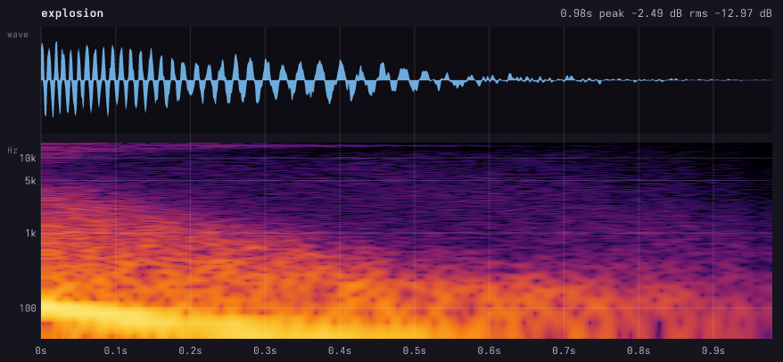
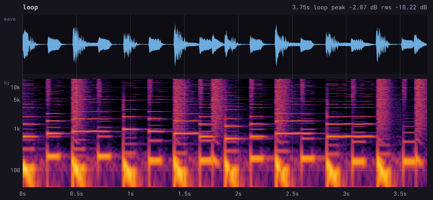
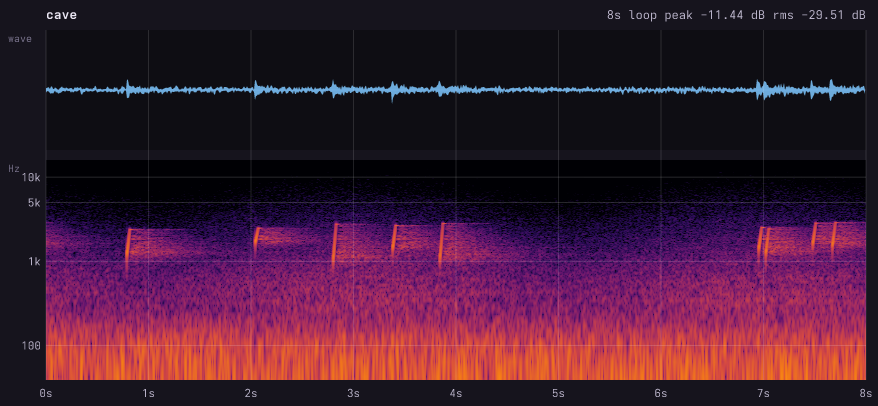
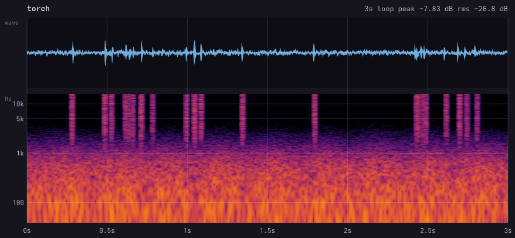
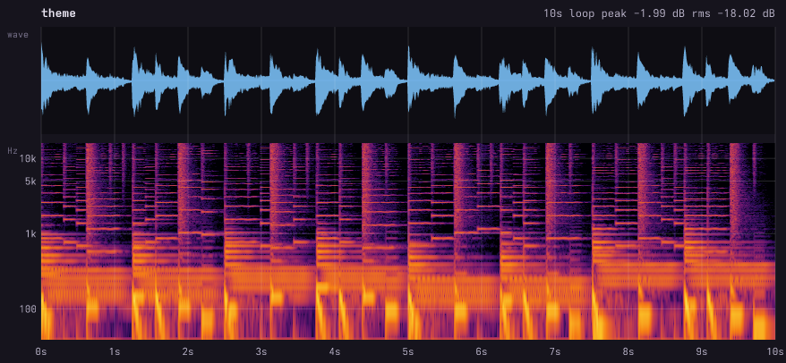

# chirp

**Game sound effects and music as code.** Write a small `.cx.js` file of tones, noise, envelopes
and patterns; chirp synthesizes WAV/OGG for every sound, chiptune songs that loop seamlessly, and
audio-sprite banks with JSON for Howler.js and Phaser. A live player rebuilds on save and plays
what you just changed.

Built for AI agents (it ships as a Claude Code skill). An agent can't hear, so every build also
writes a **waveform + spectrogram preview** and `chirp info` prints **levels, clipping and the pitch
over time**: the agent reads its sounds the way it reads its code.

Part of a family with [**vex**](https://github.com/uilianks/vex) (vector art, skeletal animation), [**pxl**](https://github.com/uilianks/pxl) (pixel art), [**kiln**](https://github.com/uilianks/kiln) (low-poly and voxel 3D) and [**loom**](https://github.com/uilianks/loom) (seamless textures and PBR materials). Inspired by
[**claude-pxl**](https://github.com/crsolver/claude-pxl) (pixel art), with the same architecture:
sandboxed source files, lazy cached builds, errors with exact locations, and a live viewer.

## Showcase

Everything here is synthesized from code in [`showcase/`](showcase/). No samples, no recordings.

### LAST CUP: a soundtrack for the vex noir scene

[](docs/media/last_cup_with_sound.mp4)

▶ **[Watch the scene with sound](docs/media/last_cup_with_sound.mp4)** · [ambience OGG](docs/media/last_cup_ambience.ogg) ·
source: [`last_cup.cx.js`](showcase/last_cup.cx.js)

Rain on the glass with droplet plinks, a distant city drone and a far-off siren, the faint 15.7 kHz
whine of an old CRT, a tired electric piano in A minor, and the neon sign's buzz, which **cuts out on
exactly the video frames where its dying letter flickers off**:


### LAST CUP (isometric): a 32 s room in sync with a pixel-art loop

[](docs/media/last_cup_iso.ogg)

▶ **[Listen (OGG)](docs/media/last_cup_iso.ogg)** · source: [`last_cup_iso.cx.js`](showcase/last_cup_iso.cx.js) ·
picture: the isometric scene in [pxl](https://github.com/uilianks/pxl/tree/main/showcase)

Scored for the pxl isometric cafe, whose animation loops every 1.6 s: the mix is exactly 20 loops.
Rain muffled by the window on the left, the city's sub-drone and a siren that never comes closer,
the CAFE sign's hum (dark on the same frames its F dies), the bar's kick-plate strip and the bulb,
the CRT's flyback whine, the robot's tired fan, a relay that clicks, servos as he lifts and lowers the
cup twice (in sync with the sip in the pixel art), a clink, oil dripping, the hooded sleeper's breathing,
a half-dead espresso machine, and a slow D minor theme. A second 10 s mix, `last_cup_iso_3d`, follows
the kiln version's clip instead.

### Forest Kit: the sounds of the vex platformer pack

[](docs/media/forest_sfx_bank.mp4)

▶ **[Listen to all 22 sounds](docs/media/forest_sfx_bank.mp4)** · [bank OGG](docs/media/forest_sfx_bank.ogg) ·
source: [`forest_kit.cx.js`](showcase/forest_kit.cx.js)

Jump, double jump, landing, footsteps (3 takes), coin, gem, heart, potion glugs, key, creaking
chest, hurt, slime, bat flap and screech, a seamless torch-crackle loop, UI sounds, and win and
game-over jingles, packed as one audio sprite with JSON offsets.

[](docs/media/forest_theme.mp4)

▶ **[Listen to the forest theme](docs/media/forest_theme.mp4)** · [OGG](docs/media/forest_theme.ogg):
a 16-bar AABA chiptune loop. Pulse lead with delayed vibrato, arpeggiated chords and triangle
bass, all built from chord names with a few lines of JS.

| coin | jump | chest_open |
|---|---|---|
|  |  |  |

## Quick start

```bash
git clone https://github.com/uilianks/chirp && cd chirp
npm install
node bin/chirp.js build examples/basics.cx.js        # -> examples/out/
node bin/chirp.js serve showcase/all.cx.js           # live player on http://127.0.0.1:4330
```

In the player, **✎ annotate** (or `a`) lets you mark spans of time (and frequency bands) on the
spectrogram, pin notes to moments and *send to Claude*. The feedback lists the bar and beat for songs
and which layers are loudest in each span, with their source lines, so "check the feedback" is enough.

```js
sfx("coin", { vol: 0.45 },
  tone({ wave: "square", freq: "B5", dur: 0.055, duty: 0.25 }),
  at(0.055, tone({ wave: "square", freq: "E6", dur: 0.18, duty: 0.25 })))
sfx("coin_big", { base: "coin", pitch: -5 })

sfx("explosion", { fx: [crush({ bits: 8 }), drive({ amount: 1.6 })] },
  noise({ color: "brown", dur: 0.5, filter: { type: "lp", from: 4000, to: 150 } }),
  tone({ wave: "sine", freq: 110, to: 35, dur: 0.4 }))

inst("lead", { wave: "square", duty: 0.25, env: [0.004, 0.1, 0.55, 0.07] })
song("theme", { bpm: 140 },
  track("lead", "E5 . G5 . C6 - B5 . | A5 . G5 . E5 - - ."),
  track("kick", "x . . . x . . ."), track("hat", ". x . x . x . x"))

bank("game_sfx", ["coin*", "explosion"])
```

```
$ chirp info sounds.cx.js coin
sfx coin: 0.4s  peak -6.8 dBFS  rms -16.79 dBFS  brightness 5196 Hz
pitch: B5 (988Hz -16dB) @0s → E6 (1318Hz -15dB) @0.05s
```

## Examples

Built by `npm run examples` from the files in [`examples/`](examples); each picture is the build's
waveform + spectrogram preview, and links to the OGG it produced.

**Chip sound effects** ([`examples/basics.cx.js`](examples/basics.cx.js)): a coin from two square
blips, and an explosion from filtered brown noise and a sub drop, crushed and driven.

```js
sfx("coin", { vol: 0.5 },
  tone({ wave: "square", freq: "B5", dur: 0.06, env: [0.001, 0.02, 0.6, 0.02], duty: 0.25 }),
  at(0.06, tone({ wave: "square", freq: "E6", dur: 0.2, env: [0.001, 0.05, 0.5, 0.18], duty: 0.25 })))

sfx("explosion", { vol: 0.8, fx: [crush({ bits: 8, rate: 16000 }), drive({ amount: 1.6 })] },
  noise({ color: "brown", dur: 0.5, env: [0.002, 0.2, 0.5, 0.6], filter: { type: "lp", from: 4000, to: 150 } }),
  tone({ wave: "sine", freq: 110, to: 35, dur: 0.4, env: [0.001, 0.2, 0.4, 0.3], vol: 0.9 }))
```

| coin ([OGG](docs/examples/coin.ogg)) | explosion ([OGG](docs/examples/explosion.ogg)) |
|---|---|
| [](docs/examples/coin.ogg) | [](docs/examples/explosion.ogg) |

**A chiptune loop** (same file): tracker patterns for lead, bass and the built-in drums.

```js
inst("lead", { wave: "square", duty: 0.25, env: [0.005, 0.08, 0.5, 0.08], vol: 0.25, vibrato: { rate: 6, depth: 0.15, delay: 0.1 } })
inst("bass", { wave: "triangle", env: [0.003, 0.05, 0.8, 0.04], vol: 0.5 })
song("loop", { bpm: 128, vol: 0.55, fx: [reverb({ size: 0.3, mix: 0.12 })] },
  track("lead", "E5 . G5 . A5 - - . | B5 . A5 . G5 - E5 . | D5 . E5 . G5 - - . | E5 - - - . . . ."),
  track("bass", "A2 . A3 . A2 . A3 . | F2 . F3 . F2 . F3 . | G2 . G3 . G2 . G3 . | E2 . E3 . E2 . E3 ."),
  track("kick", "x . . . x . . . | x . . . x . . ."),
  track("snare", ". . . . x . . . | . . . . x . . x"),
  track("hat", ". . x . . . x . | . . x . . . x x"))
```

[](docs/examples/loop.ogg)

**Ambience loops for a level** ([`examples/ambience.cx.js`](examples/ambience.cx.js)): a cave
(breathing wind, a sub rumble, drips placed by a seeded random) and a torch to place in the level
with `--mono`. Both loop seamlessly, and their WAVs carry a `smpl` loop, so Godot imports them looping.

```js
sfx("cave", { dur: 8, loop: true, vol: 0.8, fx: [reverb({ size: 0.85, damp: 0.5, mix: 0.35 }), limiter()] },
  noise({ color: "pink", dur: 8, env: [0, 0, 1, 0], vol: 0.18, tremolo: { rate: 0.25, depth: 0.6 }, filter: { type: "bp", cutoff: 420, q: 0.7 } }),
  noise({ color: "brown", dur: 8, env: [0, 0, 1, 0], vol: 0.35, filter: { type: "lp", cutoff: 90 } }),
  Array.from({ length: 9 }, () => at(rnd() * 7.8,
    tone({ wave: "sine", freq: 900 + rnd() * 900, to: 2400 + rnd() * 600, slide: 0.03, dur: 0.03, env: [0.001, 0.04, 0, 0.05], vol: 0.35, pan: rnd() * 1.6 - 0.8 }))))
```

| cave ([OGG](docs/examples/cave.ogg)) | torch ([OGG](docs/examples/torch.ogg)) |
|---|---|
| [](docs/examples/cave.ogg) | [](docs/examples/torch.ogg) |

**A theme with real harmony** ([`examples/theme.cx.js`](examples/theme.cx.js)): chords by name, a
melody indexed from a D dorian scale, an FM electric piano with chorus, swing, and a limiter.

```js
const prog = ["Dm9", "G7", "Cmaj7", "Am7"]
const S = scale("D", "dorian", 5)
inst("keys", { wave: "fm", fm: { ratio: 1, index: 2, decay: 0.35 }, env: [0.004, 0.4, 0.35, 0.3], vol: 0.18 })
const keys = prog.map((c) => chord(c, 3) + " -".repeat(7) + " " + chord(c, 3) + " -".repeat(7)).join(" | ")
song("theme", { bpm: 96, swing: 0.12, vol: 0.8, fx: [chorus({ mix: 0.35 }), reverb({ size: 0.5, mix: 0.18 }), limiter()] },
  track("keys", keys), track("bass", bass), track("lead", lead), /* + drums */)
```

[](docs/examples/theme.ogg)

## Features

- **Voices:** band-limited square (with duty), saw, triangle, sine, two-operator FM (bells, electric
  pianos, brass), white/pink/brown noise, chip sample-and-hold noise, and `sample()` for recorded WAVs
  (voice, foley, drum hits) repitched by note; ADSR envelopes, pitch slides, arpeggios, vibrato,
  tremolo, sweeping filters.
- **Effects:** delay (with ping-pong), Freeverb-style reverb, bitcrush, drive, filter sweeps, chorus,
  and a peak limiter for mixes that never clip.
- **Music:** instruments (voice options, samples or functions), built-in drum kit, tracker-style patterns
  with chords, holds, accents and swing, `chord("Am7")` / `scale("D", "dorian")` helpers for harmony.
  Songs loop seamlessly by default and also export as MIDI for a DAW.
- **Reuse:** variants (`base` + `pitch`), `play()` to layer sounds, `at()` for timing, JS for everything else.
- **Game output:** WAV (looping sounds carry a `smpl` loop that Godot imports as looping; `--mono`
  for positional sounds), OGG (`--ogg`, via ffmpeg), audio-sprite banks + Howler JSON. Silent tails are
  trimmed and loop tails wrap onto the start.
- **Agent ears:** spectrogram previews, `chirp info` pitch traces, clipping warnings, located errors.
- **Live player:** rebuilds on save, auto-plays the edited sound, loops, solos layers.

Agent workflow: [SKILL.md](SKILL.md) · Full API: [reference.md](reference.md)

## Use as a Claude Code skill

```bash
git clone https://github.com/uilianks/chirp && cd chirp && npm install
ln -s "$PWD" ~/.claude/skills/chirp-game-audio      # a link, so the skill is always this checkout
```

Requires Node ≥ 22.18. `npm run check` typechecks, runs the tests and builds every example
(`npm run examples`, which also refreshes the README media in `docs/examples/`; needs ffmpeg).

## License

[MIT](LICENSE). Portions adapted from [claude-pxl](https://github.com/crsolver/claude-pxl)
(MIT, © crsolver), via vex.
